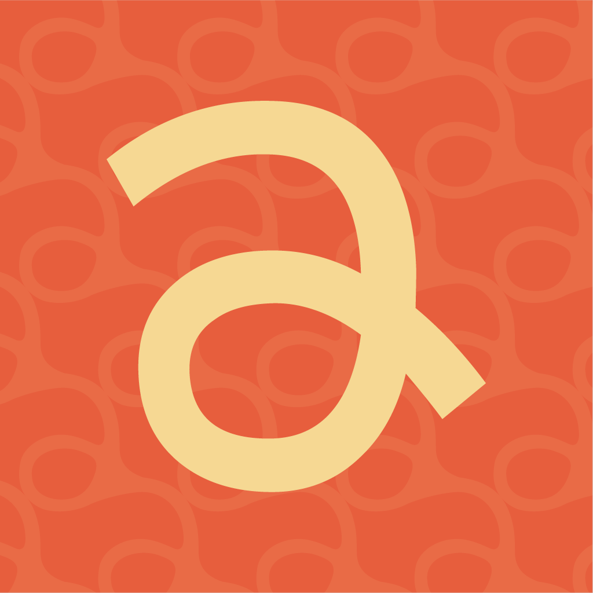

<div align="center">



# Pipa: Para Partilhar

### Share the house, not the stress. 🪁

Pipa is a native iOS app for young people who share a home. It splits household chores
fairly and automatically, based on how much free time each person has and how heavy each
task is, and turns the invisible mental load of running a house into cards everyone can see.

<br/>

[](https://apps.apple.com/br/app/pipa-para-partilhar/id6799178383)
[](https://www.apple.com/ios/)
[](https://swift.org)
[](https://developer.apple.com/xcode/swiftui/)
[](https://developer.apple.com/icloud/cloudkit/)
[](https://developer.apple.com/documentation/foundationmodels)

</div>

---

## 📑 Table of Contents

- [About](#-about)
- [Screenshots](#-screenshots)
- [Features](#-features)
- [How It Works](#-how-it-works)
- [Tech Stack](#-tech-stack)
- [Project Structure](#-project-structure)
- [Getting Started](#-getting-started)
- [Authors](#-authors)

---

## 📖 About

Living with roommates usually means one person ends up remembering everything: whose turn
it is to take out the trash, what's missing from the fridge, who still owes money for the
groceries. **Pipa** (*"para partilhar"*, "for sharing") takes that weight off a single person.

Everyone in the house tells Pipa how much free time they have during the week. Pipa then
builds a **fortnightly division** of chores that respects each person's availability and
the effort of each task, rotates recurring chores, and shows the result as interactive
cards. At the end of every cycle, the house runs a short **retrospective**, earns coins for
the work done, and can spend them on coupons that skip a chore in the next division.

Pipa is **live on the App Store**: [download it here](https://apps.apple.com/br/app/pipa-para-partilhar/id6799178383).

---

## 📸 Screenshots

<div align="center">


</div>

---

## 🚀 Features

- **🏠 Shared houses** — create a house, set up its rooms, and invite roommates through iCloud sharing; everyone sees the same data in real time.
- **⚖️ Fair, automatic division** — a scheduling algorithm distributes chores over a two-week cycle based on each member's weekly free time and each chore's duration, and rotates recurring chores between people.
- **🃏 Chore cards** — your tasks for the day as an interactive carousel; swipe to mark a chore as done.
- **🔁 Retrospectives** — when a cycle ends, the house looks back on how it went before starting the next division.
- **🪙 Points, ranks and coupons** — completed chores earn points; at the end of the cycle the rank pays out coins, which buy coupons that exempt you from a chore in the next division.
- **🛒 Shared shopping list** — build the house's list together, track who's buying what in the *Pendências* tab, and see who owes whom.
- **✨ Apple Intelligence** — on-device suggestions for the shopping list (missing complements and duplicate detection) with the Foundation Models framework, plus voice input to add items by speaking.
- **📅 Calendar sync** — your pending chores appear in a dedicated *Pipa* calendar in the Apple Calendar app.
- **📟 E-paper companion** — an ESP32 device with an e-paper screen shows the day's chores and the fortnight chart, paired with the app over the local network.
- **🌍 Accessible and bilingual** — VoiceOver support across the main screens, haptics, and full Portuguese and English localization.

---

## ⚙️ How It Works

1. **Create or join a house** — the creator sets up the rooms and invites roommates with an iCloud share link.
2. **Tell Pipa your free time** — each member fills in their weekly availability.
3. **Get the division** — once everyone has answered, the algorithm assigns every chore to a day and a person for the next two weeks, balancing the load against each person's capacity.
4. **Do the chores** — swipe the cards to complete them and earn points.
5. **Close the cycle** — run the retrospective, collect your coins, buy coupons, and start a new division.

Under the hood, all house data lives in a **shared CloudKit database** (`CKShare`). Points,
coin payouts and coupon purchases go through an `AtomicRecordStore` that always applies changes
to the server's current value and retries on conflicts, so two roommates acting at the same
time never overwrite each other. Background refresh and silent CloudKit pushes keep the
e-paper device up to date.

---

## 🛠️ Tech Stack

| Area | Tech |
|------|------|
| UI | SwiftUI · UIKit · Swift Charts |
| Persistence & sync | CloudKit (shared database, `CKShare`, subscriptions) |
| On-device AI | Foundation Models (Apple Intelligence) · Speech |
| System integrations | EventKit · UserNotifications · BackgroundTasks · PhotosUI |
| Hardware | ESP32 + e-paper display over HTTP on the local network |
| Accessibility | VoiceOver · Haptics · String Catalogs (pt-BR / en) |
| Testing | Swift Testing · XCTest (200+ tests) |
| Architecture | MVVM with protocol-based services |

---

## 📂 Project Structure

```
Cognitive-Work/
├── App/                  # App entry, AppDelegate and SceneDelegate (CloudKit share acceptance)
├── Models/               # House, Room, Chore, User, assignments, shopping list, hardware and AI models
├── ViewModels/           # One view model per screen (+ Accessibility extensions)
├── Views/                # Onboarding, Dashboard, Chores, Algorithm, Retrospective, Profile, Hardware…
├── Manager/              # CloudKit, gamification, Apple Intelligence, calendar, hardware, scores
├── Utilities/            # Scheduling algorithm, protocols, extensions, accessibility helpers
├── Enums/                # Recurrence, priorities, tiers, rooms, errors…
└── Resources/            # Fonts and assets
Cognitive-WorkTests/      # Unit tests (algorithm, models, view models, gamification, CloudKit)
Cognitive-WorkUITests/    # UI tests
```

---

## 🎯 Getting Started

### Requirements

- Xcode 26+
- iOS 26.2+
- An Apple Developer account (CloudKit and iCloud sharing need real capabilities)
- An Apple Intelligence–capable device for the shopping list suggestions

### Run

```bash
git clone https://github.com/MegaFinal/Cognitive-Work.git
cd Cognitive-Work
open Cognitive-Work.xcodeproj
```

Then set your own **Signing Team** and **Bundle Identifier**, and point the CloudKit
container to one your team owns. Sharing a house is best tested with **two iCloud accounts
on two devices**.

---

## 👥 Authors

Built at the **Apple Developer Academy | Mackenzie**.

<table width="100%">
  <tr>
    <td align="center" width="16%">
      <a href="https://github.com/Anshushu000"></a>
      <br/><sub><b>Anshu Li</b></sub><br/>
      <a href="https://github.com/Anshushu000"></a>
      <a href="https://www.linkedin.com/in/anshu-li/"></a>
    </td>
    <td align="center" width="16%">
      <a href="https://github.com/camilatoniato"></a>
      <br/><sub><b>Camila Toniato</b></sub><br/>
      <a href="https://github.com/camilatoniato"></a>
      <a href="https://www.linkedin.com/in/camilatoniato/"></a>
    </td>
    <td align="center" width="16%">
      <a href="https://github.com/carolssun"></a>
      <br/><sub><b>Carolina Sun</b></sub><br/>
      <a href="https://github.com/carolssun"></a>
      <a href="https://www.linkedin.com/in/carolina-sun/"></a>
    </td>
    <td align="center" width="16%">
      <a href="https://github.com/dayoleal"></a>
      <br/><sub><b>Dayô Araújo</b></sub><br/>
      <a href="https://github.com/dayoleal"></a>
      <a href="https://www.linkedin.com/in/dayo-araujo/"></a>
    </td>
    <td align="center" width="16%">
      <a href="https://github.com/hissapinto"></a>
      <br/><sub><b>Isabela Hissa</b></sub><br/>
      <a href="https://github.com/hissapinto"></a>
      <a href="https://www.linkedin.com/in/hissapinto/"></a>
    </td>
    <td align="center" width="16%">
      <a href="https://github.com/JonasFNMelo"></a>
      <br/><sub><b>Jonas Melo</b></sub><br/>
      <a href="https://github.com/JonasFNMelo"></a>
      <a href="https://www.linkedin.com/in/jonas-melo-/"></a>
    </td>
  </tr>
</table>
# Cognitive-Work
